<div align="center">

<picture>
  <source media="(prefers-color-scheme: dark)" srcset="docs/images/art/hero-dark.svg">
  
</picture>

[](LICENSE)  [](CHANGELOG.md) 

[Quickstart](#quickstart) · [Roles](#start-where-you-are) · [Skills](#skills) · [Lifecycle](#lifecycle) · [Install](#install) · [MCP limits](#mcp-capabilities) · [Build](#build-and-adapters) · [0.5.0](#changes-in-050)

</div>

A coding agent cannot see your test project. It guesses requirement keys and makes up suite names. These 19 skills tell it which [Katalon MCP](https://docs.katalon.com/katalon-platform/testops-mcp-server) tools to call and in what order. After you connect the MCP, the agent can read and change the real project in [Katalon True Platform](https://katalon.com) (formerly TestOps).

- **What it is:** 19 testing skills, one folder each under [`skills/`](skills/). They cover plan, design, manage, review, execute, analyze, and maintain.
- **Where it runs:** in the agent you already use. Claude Code, Codex, Cursor, Copilot, Kiro, Cline, Continue, Gemini CLI, and any agent that reads [`AGENTS.md`](AGENTS.md).
- **How it connects:** one MCP endpoint, `https://platform.katalon.io/mcp`, with browser OAuth and a workspace picker. You paste no token.
- **What it will not do:** promise work the MCP cannot do. Each skill states its limits, and every write gets a preview and one confirmation first.
- **Install:** `npx skills add katalon-labs/true-skills`, then add the MCP server.

## Quickstart

**1. Install the skills.** The [`skills` CLI](https://github.com/vercel-labs/skills) finds the agents on your machine (70+ supported) and puts the skills in each agent's skills folder.

<picture>
  <source media="(prefers-color-scheme: dark)" srcset="docs/images/art/install-dark.svg">
  
</picture>

```bash
npx skills add katalon-labs/true-skills
```

**2. Connect the Katalon MCP.** Add the server to your agent's MCP config. This is the Claude Code shape. [`docs/connect.md`](docs/connect.md) has the file and snippet for 13 clients.

<picture>
  <source media="(prefers-color-scheme: dark)" srcset="docs/images/art/connect-dark.svg">
  
</picture>

```json
{
  "mcpServers": {
    "katalon-prod-mcp": {
      "type": "http",
      "url": "https://platform.katalon.io/mcp"
    }
  }
}
```

The first call opens a browser sign-in. You pick your workspace, and the tools appear. Reload the agent if they do not. On a dedicated Katalon domain, use `https://<your.sub.domain>.katalon.io/mcp`.

**3. Ask for something real.**

```text
Set up Katalon MCP and verify my projects.
Create manual tests from requirement CEL-6 and link them.
Which requirements in this sprint have no test coverage?
Run that suite with AI and summarize what broke.
Generate a Playwright script from test case TC-1042.
Upload my Playwright report to Katalon and verify the run.
Is release 3.2 safe to ship?
```

You can also give it the whole chain: *"Analyze CEL-6, design and import the cases, build a suite, run it with AI, and tell me if we can ship."* The agent asks before it starts a Run with AI session, because that run uses Test Execution - Cloud minutes and can change data in the app under test.

## Start where you are

Say the situation in your own words. The agent picks the skill from its description, so you rarely name one.

| Role | Example prompt | Starts at |
| --- | --- | --- |
| **Manual tester** <br><sub>QA analyst, test analyst</sub> | *Design and import manual test cases from requirement CEL-6.* <br> *Run this Katalon test suite with AI and report the result.* <br> *Write me a charter to explore this feature and capture what I find.* | [`create-test-cases`](skills/create-test-cases/SKILL.md), [`test-data`](skills/test-data/SKILL.md), [`exploratory-charter`](skills/exploratory-charter/SKILL.md), [`execute-test`](skills/execute-test/SKILL.md), [`analyze-failures`](skills/analyze-failures/SKILL.md) |
| **Automation tester** <br><sub>SDET, automation engineer</sub> | *Turn test case TC-1042 into a Katalon Studio test case and script.* <br> *Run a Playwright suite, upload the report to Katalon Platform, and verify the uploaded result.* <br> *Which cases went flaky this month, and which should we repair vs regenerate?* | [`test-case-to-playwright`](skills/test-case-to-playwright/SKILL.md), [`test-case-to-katalon-studio`](skills/test-case-to-katalon-studio/SKILL.md), [`playwright-execute`](skills/playwright-execute/SKILL.md), [`upload-report`](skills/upload-report/SKILL.md), [`test-maintenance`](skills/test-maintenance/SKILL.md) |
| **Test lead** <br><sub>QA lead, QE lead</sub> | *Plan testing for this sprint: show coverage gaps and build the executable suite.* <br> *Review this suite for the pipeline and give a verdict with weak cases.* <br> *Audit requirement-to-test traceability and list orphan requirements.* | [`test-plan`](skills/test-plan/SKILL.md), [`test-estimation`](skills/test-estimation/SKILL.md), [`test-review`](skills/test-review/SKILL.md), [`test-management`](skills/test-management/SKILL.md) |
| **Test manager** <br><sub>QA manager, head of quality</sub> | *Assess whether this Katalon release is ready based on testing quality metrics.* <br> *How long will testing this release take, and with how many people?* <br> *Build the quality summary I can present to stakeholders for this release.* | [`release-analyze`](skills/release-analyze/SKILL.md), [`test-estimation`](skills/test-estimation/SKILL.md), [`test-reporting`](skills/test-reporting/SKILL.md) |

Not connected yet? Run [`platform-setup`](skills/platform-setup/SKILL.md), then [`get-started`](skills/get-started/SKILL.md). A request that spans several stages goes to [`true-platform-testing`](skills/true-platform-testing/SKILL.md), which routes by task, role, or stage. The full map from request to skill is in [`lifecycle-map.md`](skills/true-platform-testing/references/lifecycle-map.md).

## Skills

| Skill | What it does | Role |
| --- | --- | --- |
| [platform-setup](skills/platform-setup/SKILL.md) | Installs and verifies the Katalon MCP, and diagnoses sign-in or access failures. | everyone, once |
| [test-plan](skills/test-plan/SKILL.md) | Ranks the work by coverage and risk, and builds the folder and suite that hold the execution scope. | test lead |
| [test-estimation](skills/test-estimation/SKILL.md) | Sizes a test cycle as best, likely, and worst cases, and splits people across the manual and automated lanes. | test lead, test manager |
| [create-test-cases](skills/create-test-cases/SKILL.md) | Designs atomic manual cases from a requirement, skips duplicates, imports what is missing, and links each case back. | manual tester |
| [test-data](skills/test-data/SKILL.md) | Designs the data a case runs on, seeds what must exist before a run, and resets state afterwards. | manual tester, automation tester |
| [exploratory-charter](skills/exploratory-charter/SKILL.md) | Writes a charter with a mission, oracles, and a timebox, runs the session, and turns findings into defects and cases. | manual tester |
| [test-management](skills/test-management/SKILL.md) | Organizes folders and suites, and reports requirement-to-case traceability with coverage and orphans. | test lead |
| [test-review](skills/test-review/SKILL.md) | Reviews coverage, case quality, and flakiness before the pipeline, and returns Approve, Approve with fixes, or Reject. | test lead |
| [execute-test](skills/execute-test/SKILL.md) | Runs a case or suite as a manual run, a Run with AI session, or automation, and reports pass, fail, and blocked. | manual tester |
| [upload-report](skills/upload-report/SKILL.md) | Uploads Katalon Studio, JUnit XML, or Playwright reports, and checks the counts against the local run. | automation tester |
| [test-case-to-playwright](skills/test-case-to-playwright/SKILL.md) | Converts manual cases into Playwright TypeScript with Page Object Model and fixtures. | automation tester |
| [test-case-to-katalon-studio](skills/test-case-to-katalon-studio/SKILL.md) | Converts manual cases into Katalon Studio test cases and Groovy scripts. | automation tester |
| [playwright-execute](skills/playwright-execute/SKILL.md) | Runs Playwright specs, sends the report with `@katalon/playwright-reporter`, and verifies the run landed. | automation tester |
| [analyze-failures](skills/analyze-failures/SKILL.md) | Sorts failures into product defect, automation defect, and environment, and files ALM defects for real bugs. | manual tester, automation tester |
| [release-analyze](skills/release-analyze/SKILL.md) | Reads coverage, stability, and defect data, and returns Ready, Ready with risk, or Not ready with reasons. | test manager, test lead |
| [test-reporting](skills/test-reporting/SKILL.md) | Picks the few metrics that answer a stakeholder question and trends them across releases. | test lead, test manager |
| [test-maintenance](skills/test-maintenance/SKILL.md) | Finds flaky and broken cases from stability history, repairs or regenerates them, and sends the gap list to planning. | automation tester, test lead |
| [get-started](skills/get-started/SKILL.md) | Confirms the signed-in account and picks a default project after the connection works. | everyone, once |
| [true-platform-testing](skills/true-platform-testing/SKILL.md) | Routes a request to the right skill, or runs the chain from requirement to release decision. | all four |

Multi-skill playbooks are in [`combination-recipes.md`](skills/true-platform-testing/references/combination-recipes.md). Copy-paste prompts are in [`prompt-recipes.md`](skills/true-platform-testing/references/prompt-recipes.md).

## Lifecycle

<picture>
  <source media="(prefers-color-scheme: dark)" srcset="docs/images/art/lifecycle-dark.svg">
  
</picture>

Seven stages, each owned by a skill: plan, design, manage, review, execute, analyze, and maintain. `platform-setup` runs once before all of them. Maintenance closes the loop: the cases it cannot repair become a gap list, and that list goes back into the next plan. Each skill names the MCP tools it calls, and [`mcp-tool-index.md`](skills/true-platform-testing/references/mcp-tool-index.md) lists every tool on one line. [`docs/lifecycle.html`](docs/lifecycle.html) shows the same map as a page.

## Install

Every path needs the Katalon MCP server. The `skills` CLI and the copy-a-folder paths install skill files only. The Claude Code and Codex plugins bundle the MCP config.

**Any agent, with the `skills` CLI.** This is the main path.

```bash
npx skills add katalon-labs/true-skills                          # all skills, this project
npx skills add katalon-labs/true-skills --skill platform-setup   # one skill
npx skills add katalon-labs/true-skills -g                       # user-global, every agent
npx skills update                                                # pull the latest
```

**Claude Code, from the plugin marketplace.**

```bash
claude plugin marketplace add katalon-labs/true-skills
claude plugin install katalon-true-platform@katalon-true-platform-marketplace
```

Inside a Claude Code session, run the same steps as slash commands:

```text
/plugin marketplace add katalon-labs/true-skills
/plugin install katalon-true-platform@katalon-true-platform-marketplace
```

The plugin bundles the skills and an `.mcp.json` that points at `https://platform.katalon.io/mcp`. To work from a checkout, run `claude --plugin-dir plugins/katalon-true-platform`.

**Other agents.** Each row names where the skills come from. The MCP config for each client is in [`docs/connect.md`](docs/connect.md).

| Agent | Skills | MCP config |
| --- | --- | --- |
| Codex | `codex plugin marketplace add katalon-labs/true-skills`. Then run `codex`, enter `/plugins`, select **Katalon True Platform**, and install it. Start a new session to load the skills. | bundled; [`.codex/config.toml`](docs/connect.md#codex) for a project |
| Cursor, Copilot, Gemini CLI, OpenCode, Amp, Zed, Windsurf | copy `.agents/skills/` into your project | [connect.md](docs/connect.md) |
| Kiro | copy `.kiro/` (`.kiro/skills/` and `.kiro/settings/mcp.json`) | [connect.md](docs/connect.md#kiro) |
| Cline | copy `.cline/skills/` | [connect.md](docs/connect.md#cline) |
| Continue | copy `.continue/` (rules and `.continue/mcpServers/katalon.yaml`) | [connect.md](docs/connect.md#continue) |
| Kiro Crew | install the app in [`apps/katalon-testing-skills/`](apps/katalon-testing-skills/README.md), which registers all 19 skills and the MCP server | bundled |
| Agent Plugins clients | load the repo root or `plugins/katalon-true-platform/` as an [Agent Plugins 1.0.0](https://agent-plugins.org/specification) plugin | bundled `mcp.json` |
| Anything else | point the agent at [`AGENTS.md`](AGENTS.md) | root [`.mcp.json`](.mcp.json) |

A client with no remote MCP support can use the wrapper as a fallback:

```sh
npx -y mcp-remote@0.14.3 https://platform.katalon.io/mcp --transport http-first
```

> **Sign-in is browser OAuth only.** Never paste passwords, API tokens, cookies, JWTs, MFA codes, or OAuth callback URLs into chat, and never commit them. The skills enforce this.

## MCP capabilities

Each skill names its limits up front, so the agent does not promise work the platform cannot do.

**Through the MCP:** list projects and repositories, read requirements, search the Knowledge Base, create, update, and link test cases, manage suites and folders, create manual and automated runs, start, configure, and end a TestPak, start Run with AI, poll AI sessions, rerun an automated execution, read and edit schedules, record manual results, upload evidence, read results and quality metrics, use Test Execution - Cloud apps and tunnels, work with TrueTest sessions and journey maps, read the team's Kai memory, and file ALM-linked defects.

**Not through the MCP:** create requirements, create a formal Test Plan entity, stop a running automated execution, look up users, edit suite collections, or inspect the live app UI without a browser tool. A named suite holds the execution scope in place of the Test Plan entity.

Some work lives in the product UI: object capture in Studio, custom fields, Git config and governance in the TestOps UI, self-healing, Time Capsule, and Live Monitor. The full list is in [`capability-boundaries.md`](skills/true-platform-testing/references/capability-boundaries.md).

## Build and adapters

<picture>
  <source media="(prefers-color-scheme: dark)" srcset="docs/images/art/library-dark.svg">
  
</picture>

The skill text lives once, in `skills/`. `node scripts/build-adapters.mjs` writes every agent folder, manifest, and MCP config from it, and CI fails when a generated file is stale.

```text
skills/                              source, 19 skills
shared/references/                   one copy of each shared reference, synced into skills/
scripts/build-adapters.mjs           writes every adapter below
plugins/katalon-true-platform/       Claude Code, Codex, and Cursor plugin   (generated)
.claude-plugin/  .agents/plugins/    plugin marketplaces                     (generated)
.agents/skills/                      skills folder for most agents           (generated)
.kiro/  .cline/  .continue/          Kiro, Cline, Continue                   (generated)
.codex/  .cursor/  .vscode/          MCP config per client                   (generated)
apps/katalon-testing-skills/         Kiro Crew app                           (generated)
.mcp.json  mcp.json  plugin.json     MCP config and Agent Plugins manifest   (generated)
AGENTS.md  docs/connect.md           agent index and per-client MCP page     (generated)
```

## Changes in 0.5.0

- Skills use the live Katalon MCP tool names, checked against the server on 2026-10-20. `create_test_run` with a `mode` replaces the manual and scheduled run tools. `update_test_run` configures, starts, and ends a TestPak. The `fetch_*_metrics` tools replace the insights and stability tools. `read_test_cases` and `update_test_cases` take lists.
- Run with AI no longer starts on its own. The agent shows the suite, environment, mode, and schedule, and waits for a yes.
- The build stops writing six old rule folders. Each agent reads a native skills folder, which removes about 1.6 MB of duplicate text.
- New [`docs/connect.md`](docs/connect.md) gives the MCP snippet for 13 clients, and [`docs/mcp-tools.json`](docs/mcp-tools.json) holds the 74-tool contract that the validator checks.

The full list is in [CHANGELOG.md](CHANGELOG.md).

## Contributing

Edit `skills/` only. Everything else is generated. Then run:

```bash
node scripts/validate-skills.mjs    # skills/ matches scripts/skills.config.mjs
node scripts/build-adapters.mjs     # regenerate every agent config
```

The build is deterministic. A second run with no skill changes produces no diff, and CI rejects adapters that are out of sync. Details are in [CONTRIBUTING.md](CONTRIBUTING.md).

The ChatGPT plugin package has its own sources under `chatgpt/` and its own build. The build copies an allowlist into `dist/chatgpt/` and refuses anything the OpenAI plugin directory rejects:

```bash
python3 scripts/build-chatgpt-plugin.py      # dist/chatgpt/katalon-true-platform/ and the ZIP
python3 -m unittest discover -s tests        # one bad fixture per forbidden item
```

Listing copy, review cases, and the submission checklist are in [`docs/chatgpt/`](docs/chatgpt/).

## Support

- Bugs, questions, and skill requests: [open an issue](https://github.com/katalon-labs/true-skills/issues)
- Katalon platform and MCP support: [support.katalon.com](https://support.katalon.com), or your Katalon Customer Success Manager
- MCP server documentation: [docs.katalon.com](https://docs.katalon.com/katalon-platform/testops-mcp-server)

## Privacy

The skills are markdown files that run inside the agent you already use. This repository collects nothing. Platform operations go to your own Katalon workspace over OAuth. The [Katalon Privacy Policy](https://katalon.com/terms#privacy-policy) covers what Katalon does with that data.

## License

[MIT](LICENSE) © Katalon. "Katalon" and "Katalon True Platform" are trademarks of Katalon, Inc.
